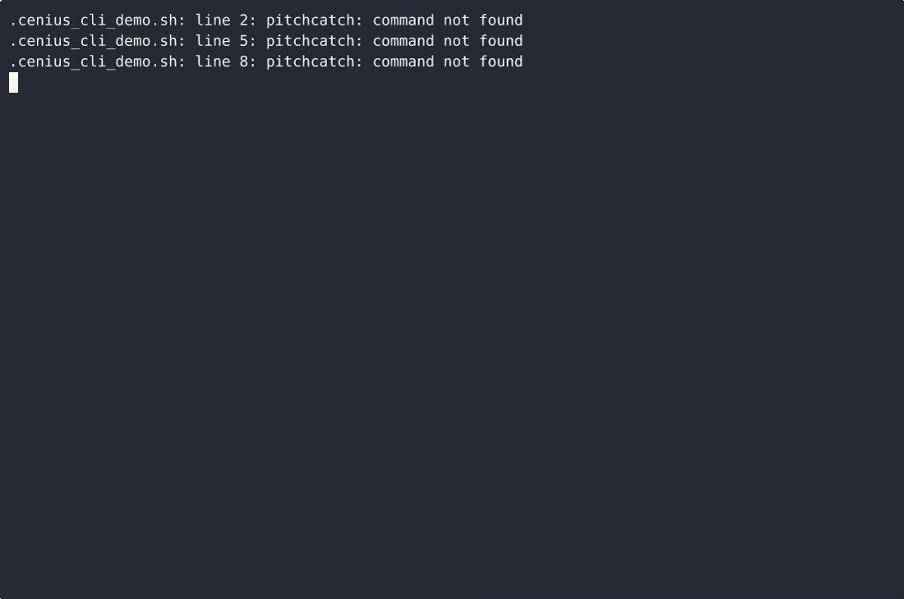
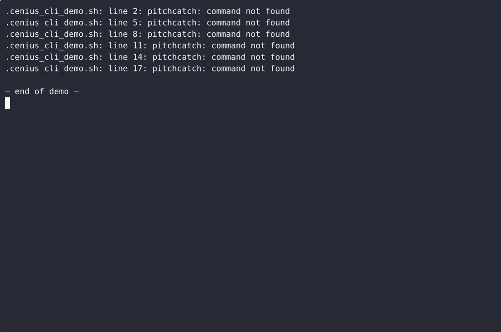

# Pitchcatch — complete Full-stack app command-line tool example app

Need a self-hosted command-line tool? **Pitchcatch** is the open-source answer: a Full-stack app project you can clone, run, and own. Pitchcatch is a single-file, standard-library Python command-line tool that lets a coach or pitcher record a bullpen session through interactive terminal prompts, persist it to a local JSON file, and read the session…. Every Pitchcatch line of code is here — no stripped demo, no paywalled features. Apache-2.0-licensed; [remix Pitchcatch on cenius.ai](https://cenius.ai/marketplace/p/pitchcatch?ref=gh&utm_campaign=pitchcatch-webapp) for a bespoke custom version.


[](LICENSE)  [](https://cenius.ai)

[](https://cenius.ai/marketplace/p/pitchcatch?ref=gh&utm_campaign=pitchcatch-webapp)

> **▶ [Open & edit in cenius.ai](https://cenius.ai/marketplace/p/pitchcatch?ref=gh&utm_campaign=pitchcatch-webapp)** — one click to an editable workspace: describe changes in plain English, get an instant preview, one-click deploy and host. Modifications made on the platform come with full rebrand & relicense rights.

_Local clone? See [Quick start](#quick-start) below. cenius.ai is the zero-setup path._

## Demo


▶ **[Watch the full demo video](https://cenius.ai/marketplace/p/pitchcatch?ref=gh&utm_campaign=pitchcatch-webapp)** — the complete walkthrough, playing on the project's cenius.ai page · [MP4 file](.github/media/demo.mp4)

## Screenshots

 

## Architecture

Folder layout: `tests/`. Run `./install.sh` once to install packages and populate demo data — the app is ready to use immediately after. Built in Full-stack app (14 files). Full setup details: [`INSTALL.md`](INSTALL.md).

## Features

- Pitch mix notation grid
- Strike-zone heat tally by count
- Bullpen session volume tracker
- Interactive pitch entry loop
- Local JSON persistence
- Local pitcher profile with optional PIN gate
- Profile-wide aggregate mix and heat
- ANSI heat shading with a plain fallback
- Custom pitch arsenal per profile

## Quick start

```bash
./install.sh   # installs dependencies + seeds demo data
```

See [`INSTALL.md`](INSTALL.md) for full setup and usage instructions.

## Usage guide

Every example below is copy-pasteable. They assume you have run
`python3 pitchcatch.py seed` once (see INSTALL.md step 2); without it, start with
`python3 pitchcatch.py profiles --new "Your Pitcher"`.

### 1. Record a bullpen session

```bash
python3 pitchcatch.py log --profile "Ace Ramirez"
```

Pitchcatch asks for the session kind and an optional pitch target, then loops on one
pitch at a time:

```
Session kind (bullpen/game) [bullpen]:
Pitch target (Enter for none): 25
Session 28740eba  |  2026-10-15  |  bullpen  |  target 25 pitches
First prompt is pitch type. Answer q (or press Enter) to finish and save.
[0 pitches]
Pitch type  1=FF  2=SI  3=FC  4=SL  5=CU  6=CB  7=CH  8=KN  9=OTHER  0=full list  u=undo  q=finish
```

The header line above each prompt is the running state: how many pitches are in the
session, the count of the last pitch and the last pitch itself
(`[7 pitches]  count 0-2  last: SL Z7 0-2 swing 85.0 mph`).

| Answer | Meaning |
| --- | --- |
| `FF` (or `1` with the default arsenal) | Pitch type; the accepted codes are listed. |
| `7` / `out` | Zone 1–9 (Z1 top-left, Z9 bottom-right) or off the plate. |
| `1-2` | Count, balls then strikes. `5-0` and `12` are rejected with the accepted form. |
| `swing` (`s`), `called` (`c`), `ball` (`b`), `foul` (`f`), `inplay` (`i`) | Result. |
| *(Enter)* | Velocity is skipped and stored as empty. |
| `u` | Undo the previous pitch (rewrites the store). |
| `q` or *(Enter)* | Finish: the session is closed and saved. |

_Full guide: [`USAGE.md`](USAGE.md)_

## FAQ

### How do I run Pitchcatch on my own server?

It runs entirely on your own machine. Clone, run `./install.sh`, and follow [`INSTALL.md`](INSTALL.md) — the whole stack is in this repo, no external dependencies required.

### Can I remove the Pitchcatch name and use my own?

Absolutely. [Open it on cenius.ai](https://cenius.ai/marketplace/p/pitchcatch?ref=gh&utm_campaign=pitchcatch-webapp) and remix it there — platform modifications come with full rebrand and relicense rights over your derivative, so the result is entirely yours.

### What is Pitchcatch built with?

Pitchcatch runs on Full-stack app. This repo holds the full production source: you can inspect every part of it before deploying. Highlights include local pitcher profile with optional PIN gate.

### Can non-developers customise Pitchcatch?

Non-developers can use [cenius.ai](https://cenius.ai/marketplace/p/pitchcatch?ref=gh&utm_campaign=pitchcatch-webapp) to make changes. Describe your goal in everyday language and the platform delivers an updated, ready-to-run project — zero coding on your part.

### Can I use Pitchcatch in a commercial project?

The code is under the Apache-2.0 license, which allows commercial use without restriction. You can build, sell, and deploy it freely. Full text: [LICENSE](LICENSE).

## License & rebranding

Released under the [Apache License 2.0](LICENSE) (© 2026 Cenius AI) — free for personal and commercial use. The Cenius name/logo are trademarks (see NOTICE).

**Need a customized version?** [Remix this app on cenius.ai](https://cenius.ai/marketplace/p/pitchcatch?ref=gh&utm_campaign=pitchcatch-webapp) — modifications made on the platform come with **full rebrand & relicense rights** over your derivative.

## Built with cenius.ai

This entire application — code, design, seeded demo data — was generated on **[cenius.ai](https://cenius.ai)** from a plain-English description.

- 🚀 [Build your own app on cenius.ai](https://cenius.ai)
- 🎛️ [Remix Pitchcatch on the marketplace](https://cenius.ai/marketplace/p/pitchcatch?ref=gh&utm_campaign=pitchcatch-webapp) — open it in a workspace, prompt for changes, and ship your own version.

More open-source apps: [the Cenius-ai catalog](https://github.com/Cenius-ai) · [showcase index](https://github.com/Cenius-ai/showcase)
